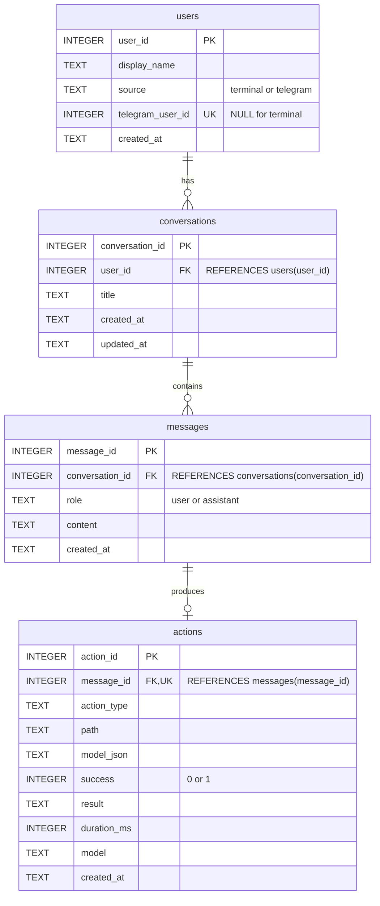

# Database diagram

Open this file in VS Code and press **Ctrl+Shift+V** to see the drawing. This needs the extension "Markdown Preview Mermaid Support".

The SQL that creates these tables is in `fs_assistant/schema.sql`. Queries that join them are in `queries.sql`.
